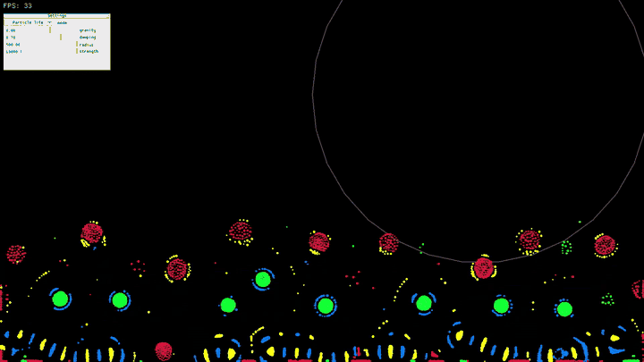
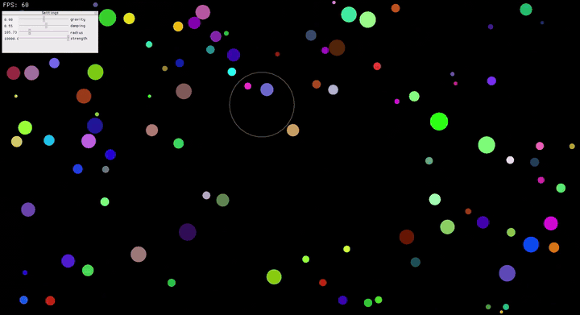
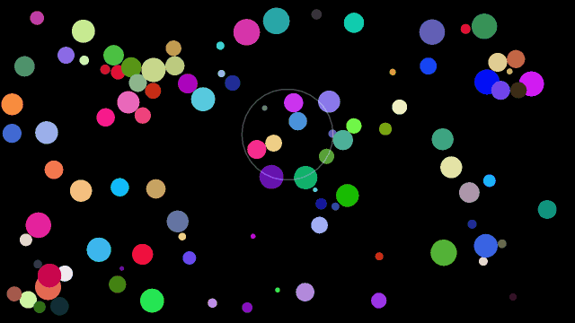
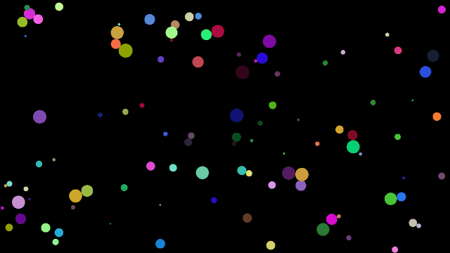
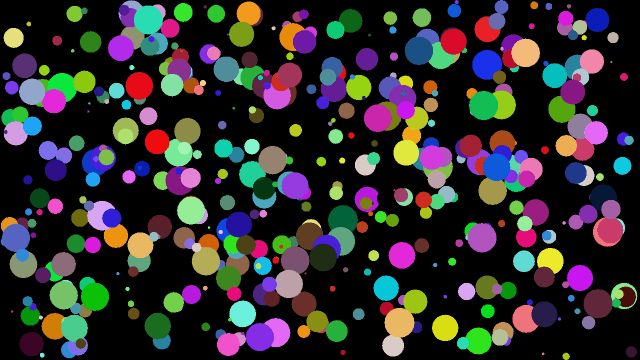

# Particule

A real-time 2D particle simulation written in Rust, built as a project to learn the language.

> 🚧 Work in progress



## Features

- [x] Window, render loop and FPS counter
- [x] Particles with gravity and edge bounces
- [x] Particle-particle collisions (naive O(n²))
- [x] Spatial grid to speed up collisions
- [x] Mouse attract / repel
- [x] Settings panel with sliders
- [x] Mode menu: Classic / Particle life
- [x] Particle life: colour types with random attraction rules
- [ ] Continuous-colour particle life
- [ ] Boids
- [ ] Multithreading with rayon

## Progress

Demos recorded along the way, newest first.

### 05 · Particle life

A second mode, picked from the settings panel. Each particle has one of 4 colours, and a random 4×4 table says how much each colour is attracted to or repelled by each other one.
The rules are not symmetric, so cells, membranes and chasing chains appear on their own. "Randomize rules" creates a new universe; range, force and friction are live sliders.


### 04 · Live settings panel

A settings window with sliders changes gravity, bounce damping, mouse radius and mouse strength while the simulation runs.
Negative gravity makes everything fall up.



### 03 · Mouse attract and repel

Hold left click to pull the particles inside the ring toward the cursor, right click to push them away.
Collisions now use a spatial grid, so only nearby particles are compared.



### 02 · Particle collisions

Particles bounce off each other and stack up instead of passing through (naive O(n²) check).



### 01 · Gravity and edge bounces

500 random particles falling with gravity, bouncing off the window edges with damping.



## Running

Requires [Rust](https://rustup.rs/).

```bash
cargo run --release
```

### Controls

| Input | Action |
|---|---|
| Left click (hold) | Attract particles inside the ring |
| Right click (hold) | Repel particles inside the ring |
| Tab | Show / hide the settings panel |
| F11 | Toggle fullscreen |

## Built with

- [macroquad](https://github.com/not-fl3/macroquad): window, rendering, input
